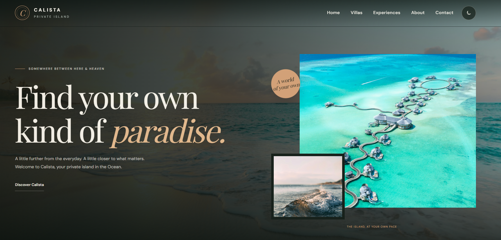
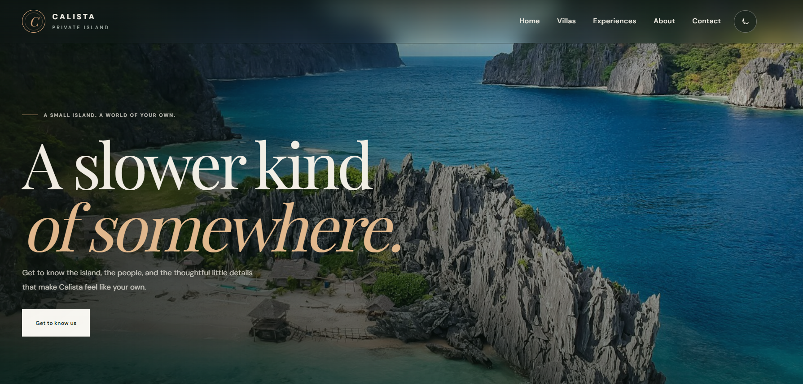
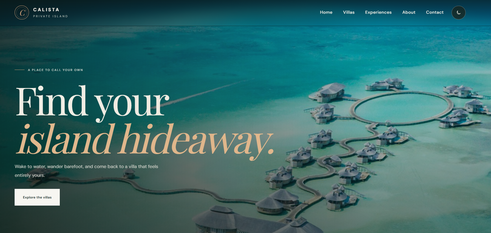
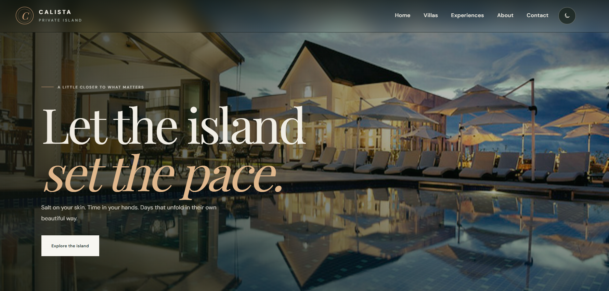
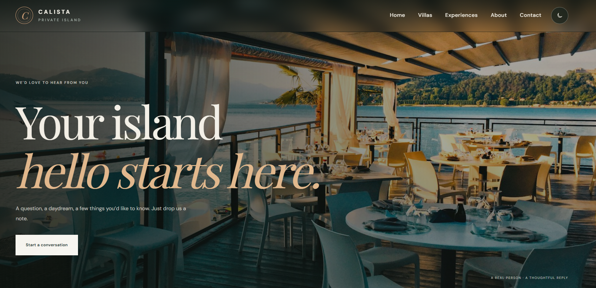

# Calista Resort — Luxury Island Escape

A premium, multi-page resort website designed to showcase the beauty of a private island getaway. Calista combines elegant visuals, immersive animations, responsive layouts, and a refined luxury aesthetic to create an engaging digital experience.


## 📸 Screenshots

### Home Page


### About Page


### Villas Page


### Experiences Page


### Contact Page


## ✨ Features

- **Luxury Design:** Elegant layouts, refined typography, and immersive resort imagery.
- **Responsive Layout:** Optimized for desktop, tablet, and mobile devices.
- **Multi-Page Website:** Dedicated pages for Home, About, Villas, Experiences, and Contact.
- **Smooth Animations:** Engaging motion effects powered by GSAP and ScrollTrigger.
- **Interactive Sliders:** Dynamic content presentation using Swiper.js.
- **Booking Interface:** A dedicated booking-related JavaScript module.
- **Custom Styling:** Organized CSS with separate responsive styles.
- **Visual Storytelling:** Beautiful imagery highlighting island life, accommodation, dining, and relaxation.
- **Custom Favicon:** Branded browser icon for a polished appearance.

## 🛠️ Technologies Used

- HTML5
- CSS3
- JavaScript
- GSAP
- GSAP ScrollTrigger
- Swiper.js

## 📂 Project Structure

```text
calista-resort/
│
├── index.html
├── about.html
├── villas.html
├── experiences.html
├── contact.html
│
├── assets/
│   ├── css/
│   │   ├── style.css
│   │   └── responsive.css
│   │
│   ├── js/
│   │   ├── main.js
│   │   └── booking.js
│   │
│   ├── images/
│   │   ├── beach/
│   │   ├── dining/
│   │   ├── experiences/
│   │   ├── gallery/
│   │   ├── villas/
│   │   └── favicon.svg
│   │
│   └── vendor/
│       ├── gsap.min.js
│       ├── ScrollTrigger.min.js
│       ├── swiper-bundle.min.js
│       └── swiper-bundle.min.css
│
└── screenshots/
    ├── home.png
    ├── about.png
    ├── villas.png
    ├── experiences.png
    └── contact.png
```

## 🚀 Getting Started

### 1. Clone the Repository

```bash
git clone <your-github-repository-url>
```

### 2. Navigate to the Project

```bash
cd calista-resort
```

### 3. Run the Website

Open `index.html` in your browser, or use the **Live Server** extension in Visual Studio Code for a local development server.

No backend installation is required to view the static frontend.

## 🎯 Project Goals

- Create a premium digital identity for a luxury island resort.
- Deliver an immersive and visually engaging browsing experience.
- Showcase accommodation, resort experiences, and dining through dedicated pages.
- Demonstrate modern frontend development, animation techniques, and responsive design.

## 👨‍💻 Developed By

**Q&B Tech Studio**

We create modern websites and digital experiences focused on design, functionality, and user experience.

---